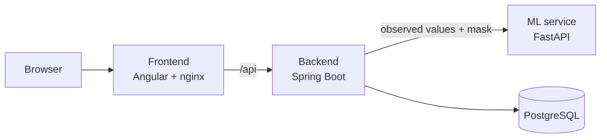

# Provider-Aware Adaptive Information Acquisition

Master of Software Engineering capstone project, American University Kyiv.

Decision-support systems often depend on information from several providers (databases, external
services, paid APIs) that differ in cost, response time and availability. This project builds a
platform that starts a prediction from a small set of known information and then decides, record
by record, whether querying another provider is worth it. Every decision, provider call,
prediction, cost and delay is recorded, so that an adaptive strategy can be compared with simpler
strategies and with acquiring everything.

> Research question: can adaptive information acquisition reduce the amount, cost and time of data
> acquisition while keeping prediction quality close to a system that uses all available data?

The experiments use the UCI *Default of Credit Card Clients* dataset. Information providers are
simulated from the complete records; the platform does not make real credit decisions.

**Current state (Phase 2, Alpha):** data pipeline, baseline and partial-information models,
prediction service, simulated providers, persisted acquisition sessions and the step-by-step
acquisition loop with a fixed-order policy are implemented and tested. The adaptive policy, the
experiment runner and the user interface views are planned for the next phases.

## Architecture



The backend runs acquisition sessions: it loads the initial information of a record, asks a policy
which provider to query next, calls the (simulated) provider, sends only the observed values to the
ML service and stores every step. Complete records and labels never reach the policy or the model.
Details: [docs/architecture.md](docs/architecture.md).

## Repository layout

| Path | Content |
|---|---|
| [`backend/`](backend/README.md) | Spring Boot application: REST API, sessions, policies, providers, persistence |
| [`ml-service/`](ml-service/README.md) | Python: data preparation, model training and analysis, FastAPI prediction service |
| [`frontend/`](frontend/README.md) | Angular application |
| [`config/`](config/README.md) | Feature grouping and provider scenarios shared by Java and Python |
| [`data/`](data/README.md) | Dataset provenance and split manifest (the data itself is downloaded) |
| [`docs/`](docs/architecture.md) | Architecture and design decisions |
| `scripts/smoke_test.py` | End-to-end check of the running platform |
| `compose.yaml` | Docker Compose for PostgreSQL and all services |

## Prerequisites

| Tool | Required | Tested with | Needed for |
|---|---|---|---|
| Python | 3.13 (3.14 is not supported yet) | 3.13.9 | Data preparation, training, ML service, smoke test |
| Docker with Docker Compose | A recent version | Docker 29.8, Compose 5.6 | PostgreSQL, backend tests (Testcontainers), running all services |
| Java (JDK) | 25 | Temurin 25.0.4.1 | Backend development (Maven 3.10 is downloaded by the included Maven Wrapper) |
| Node.js (includes npm) | 24.15 or newer; 22.22.3 or newer and 26 or newer also work | 24.22.0 (npm 11.19) | Frontend development |

Only Python and Docker are needed to run everything in containers.

## Running locally

### Step 1 — prepare the data and train the model (once)

The dataset and the trained model are not stored in Git; these commands download the dataset
(checking its checksum), split it using the committed split manifest and train the model.

Windows (PowerShell):

```powershell
cd ml-service
py -3.13 -m venv .venv
.venv\Scripts\python -m pip install -r requirements-dev.txt
.venv\Scripts\python -m pip install -e .
.venv\Scripts\python -m ml_service.data.prepare
.venv\Scripts\python -m ml_service.training.train
cd ..
```

Linux / macOS:

```bash
cd ml-service
python3.13 -m venv .venv
.venv/bin/python -m pip install -r requirements-dev.txt
.venv/bin/python -m pip install -e .
.venv/bin/python -m ml_service.data.prepare
.venv/bin/python -m ml_service.training.train
cd ..
```

This creates `data/features/`, `data/restricted/` and `ml-service/artifacts/` (all ignored by Git).

### Step 2, option A — run everything in Docker

```bash
docker compose --profile app up -d --build
```

| Address | Service |
|---|---|
| http://localhost:4200 | Frontend (and the API under `/api`) |
| http://localhost:8080/api/v1/providers | Backend API |
| http://localhost:8080/actuator/health | Backend health |

The ML service is only reachable from the backend. Stop everything with
`docker compose --profile app down` (the database volume is kept).

### Step 2, option B — run the services for development

1. Start PostgreSQL only: `docker compose up -d`
2. Start the ML service (port 8000), from `ml-service/`:
   `.venv\Scripts\python -m ml_service.inference` (Linux/macOS: `.venv/bin/python -m ml_service.inference`)
3. Start the backend (port 8080), from `backend/`: `.\mvnw spring-boot:run` (Linux/macOS: `./mvnw spring-boot:run`)
4. Start the frontend (port 4200), from `frontend/`: `npm ci` once, then `npm start`

In IntelliJ IDEA: open the repository folder, load `backend/pom.xml` as a Maven project, run
`BackendApplication` with the working directory set to `backend`, and use `ml-service/.venv` as
the Python interpreter of the `ml-service` module.

### Step 3 — try it

Run one complete session with checks:

```bash
python scripts/smoke_test.py            # services already running (option A or B)
python scripts/smoke_test.py --compose  # starts the containers, tests, stops them
```

Or call the API yourself (record 4 is in the validation split):

```bash
curl -X POST http://localhost:8080/api/v1/sessions -H "Content-Type: application/json" -d "{\"recordId\": \"4\", \"policyId\": \"FIXED_ORDER\"}"
curl -X POST http://localhost:8080/api/v1/sessions/<sessionId>/advance
curl http://localhost:8080/api/v1/sessions/<sessionId>
```

In Windows PowerShell write `curl.exe` instead of `curl`.

## Running the tests

| Part | Command (from the module folder) | Notes |
|---|---|---|
| ML service | `.venv\Scripts\python -m pytest` | Real-data tests run after step 1, otherwise they are skipped |
| Backend | `.\mvnw test` | Needs Docker (starts PostgreSQL with Testcontainers) |
| Frontend | `npm test` | |
| Whole system | `python scripts/smoke_test.py --compose` | From the repository root |

## Dataset

Yeh, I. (2009). *Default of Credit Card Clients* [Dataset]. UCI Machine Learning Repository.
https://doi.org/10.24432/C55S3H — licensed under CC BY 4.0. See [data/README.md](data/README.md).

## Author

Kseniia Makarova. Supervisor: Prof. Viktor Putrenko.
