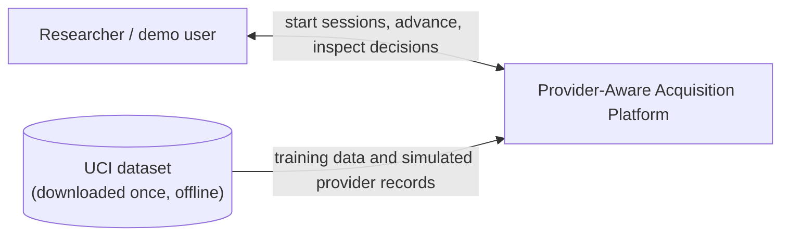
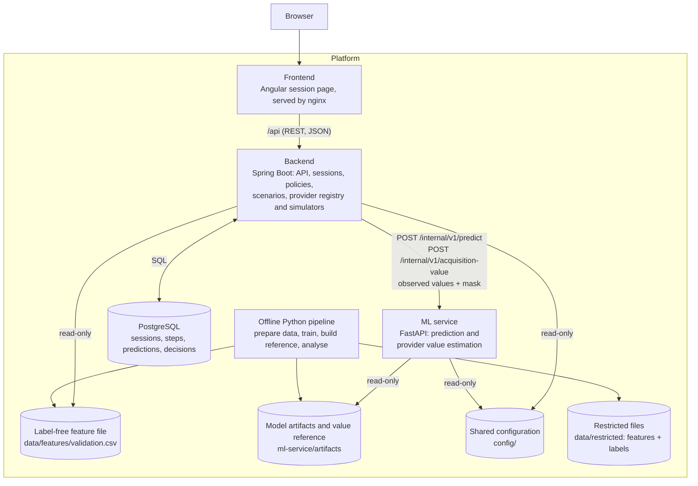
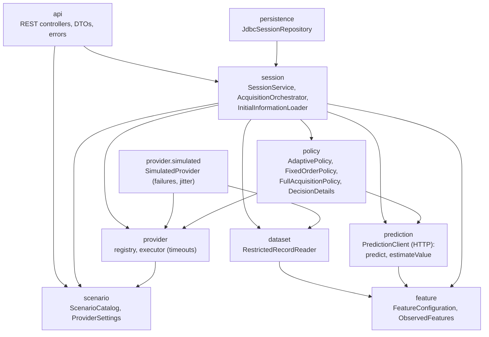
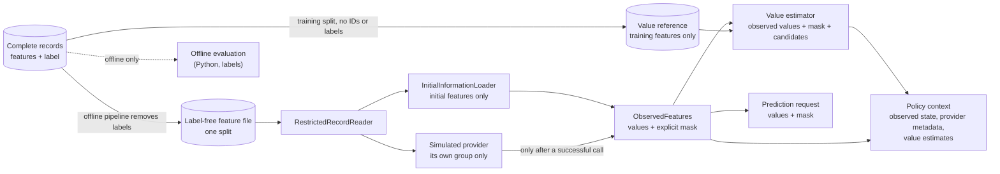
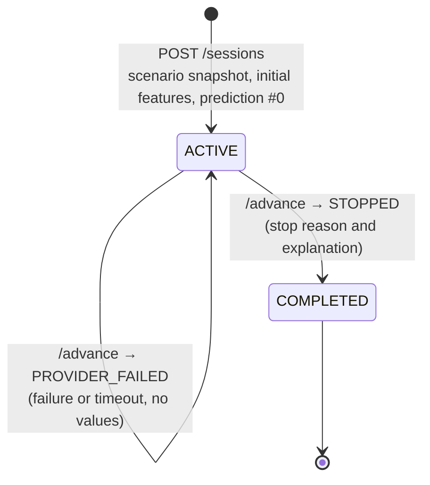
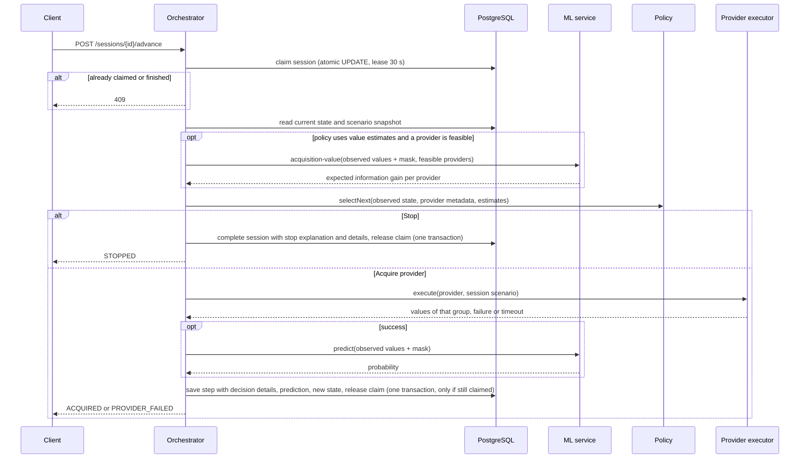
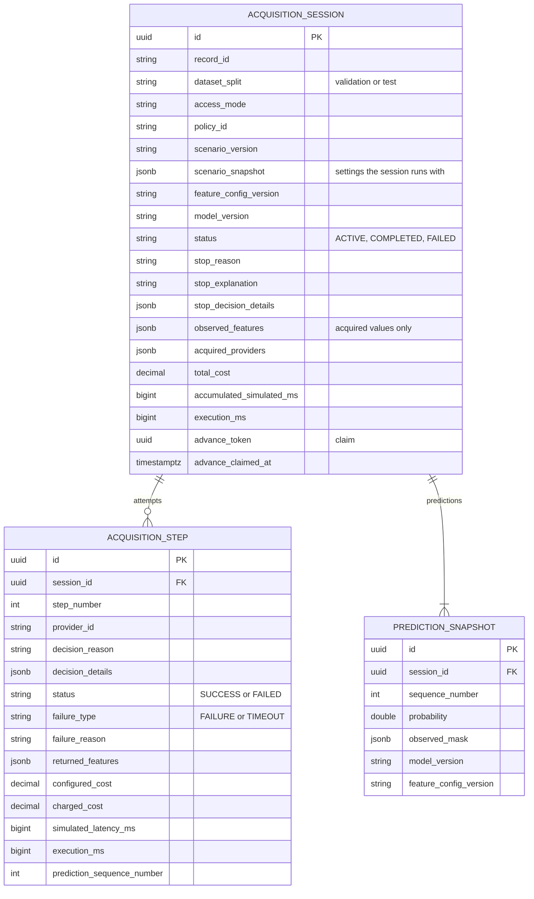
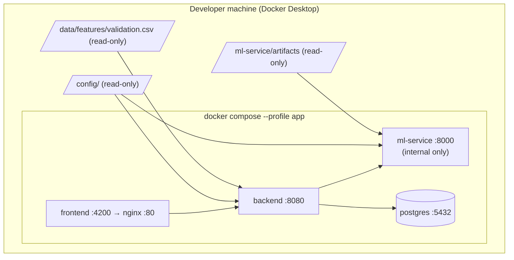

# Architecture

This document describes the system as it is implemented at the end of Phase 3 (MVP). Planned
parts are marked as such. Requirement IDs (FR, NFR, ER) refer to the requirements of the first
chapter.

## 1. Purpose

The platform studies **provider-aware adaptive information acquisition**: a prediction starts from
a small set of known information, and the system decides, record by record, whether to query
additional information providers. Providers differ in cost, latency, reliability and availability,
and each one reveals a group of features. The system records every decision with its explanation
so that adaptive and simple strategies can be compared on prediction quality, cost, number of calls
and time.

The data is the UCI *Default of Credit Card Clients* dataset. Providers are **simulated** from the
complete records; this is an experimental setup, not a real credit-decision system.

## 2. System context



## 3. Containers



| Container | Technology | Responsibility |
|---|---|---|
| Frontend | Angular 22, nginx | Session page: start a session with a record, policy and scenario; advance step by step or to the end; show decisions, observed information, predictions, costs and stop reasons. nginx forwards `/api` to the backend. |
| Backend | Java 25, Spring Boot 4.1 | Public REST API, session lifecycle, acquisition policies, scenarios, provider registry, simulated providers, persistence |
| ML service | Python 3.13, FastAPI, scikit-learn | Predicts the probability of default from any legal partial observation and estimates the expected information gain of each candidate provider |
| PostgreSQL | PostgreSQL 18 | Sessions with scenario snapshots, provider attempts with decision details, prediction snapshots |
| Offline pipeline | Python, pandas, scikit-learn | Downloads and splits the dataset, trains and selects the model, builds the value reference, analyses provider value and the estimator |

The ML service receives **only observed values, their mask and candidate provider IDs**, never a
record identifier, so it cannot look up anything else. The frontend talks only to the backend.

## 4. Backend components



| Package | Responsibility | Must not use |
|---|---|---|
| `api` | HTTP endpoints, request validation, response DTOs, error mapping | dataset, simulated providers |
| `session` | Creating sessions with a scenario, running one decision per `/advance`, history | — |
| `policy` | Deciding *acquire provider X* or *stop* from an `AcquisitionContext`, with explainable details | dataset, simulated providers, provider executor, persistence, `PredictionClient` |
| `provider` | Provider interface, registry (definitions + scenario settings), executor (validation, timeouts, charging) | — |
| `provider.simulated` | Simulated providers that reveal their own feature group from the complete records | — |
| `scenario` | Loading, validating and choosing provider scenarios | — |
| `prediction` | Client for the ML service (predictions and value estimates) | dataset, provider, scenario, session |
| `dataset` | The only access to complete records, through two narrow methods | — |
| `feature` | Shared feature grouping and the legal-observation rules | any other package |
| `persistence` | SQL storage of sessions, steps and snapshots | — |

A policy may read the value-estimate *data type* from the `prediction` package, but it may not use
the `PredictionClient`: the orchestrator asks for estimates and passes them in the context. The
"must not use" rules and the absence of package cycles are checked by ArchUnit tests on every
build. Further tests run each rule against deliberately broken classes to show that the rules
really detect violations.

## 5. Data visibility boundary

The central correctness property: a policy, the value estimator and the predictive model may only
see values that have been acquired, and never the label (ER-6, NFR-8).



| Safeguard | Where it is enforced | How it is tested |
|---|---|---|
| Labels never reach the backend | The data pipeline writes label-free `features/<split>.csv`; the reader refuses any file whose columns are not exactly ID + model features | Python file tests; Java reader tests with target/demographic columns |
| Training records are never served | Only one split file is loaded; database check allows only `validation` or `test` | Reader and schema tests; real data compared with the split manifest |
| Test records only for final evaluation | `FINAL_EVALUATION` mode starts only with the `final-evaluation` Spring profile | Startup guard tests; verified on the packaged application |
| A session starts with the initial features only | `InitialInformationLoader` | Service, API, database and outgoing ML request checks |
| A provider reveals only its own group | Reader API offers only `initialFeatures(id)` and `providerGroup(id, provider)`; executor rejects any other result | Provider, executor and per-step API tests |
| Unacquired values are never visible | `ObservedFeatures` holds only acquired values; stored state is re-validated on every read; session responses carry provider characteristics without feature names | After every `/advance`, responses are searched for hidden feature names (API tests, smoke test); ML request masks checked step by step |
| Value estimates use only permitted information | The estimator receives the observed values, mask and candidates; its reference sample holds only the 19 training features, without IDs, labels or demographics | Builder reads only the train split; artifact content tests; estimates depend only on the request; the running service loads no data or training code |
| Policies cannot reach data or outcomes | `AcquisitionContext` has no record identifier; policies see scenario-derived probabilities, never the simulated draw of a call; ArchUnit rules | Architecture tests, including a rule against `PredictionClient` |
| Missing ≠ zero | Missing values come only from the mask; masks must be whole groups | Java and Python mask tests; zero-value tests |
| Online inference independent of training data | `ml_service.inference` imports no data/training/analysis code | Static and runtime import tests |
| Physical separation in containers | Backend container mounts only the validation feature file; ML container mounts only model artifacts and has no published port | Verified in the running Compose stack |

## 6. Feature grouping, model and value estimation

### 6.1 Feature grouping

`config/feature-groups.json` is read by both Java and Python (version **fg-2**):

| Source | Features |
|---|---|
| Initial information (known at the start) | `LIMIT_BAL`, `BILL_AMT1`, `PAY_AMT1` |
| Repayment History provider | `PAY_0`, `PAY_2`–`PAY_6` |
| Billing History provider | `BILL_AMT2`–`BILL_AMT6` |
| Payment History provider | `PAY_AMT2`–`PAY_AMT6` |

The demographic columns are excluded. Because the initial features are always known and providers
reveal whole groups, every session is in one of **8 observation states**. The grouping was refined
from the first chapter's version during Phase 2; the reasons and evidence are in
[decisions/001-feature-grouping-fg-2.md](decisions/001-feature-grouping-fg-2.md).

### 6.2 Model

A single *mask-aware* gradient-boosting model is used for every state and every strategy, so
differences between strategies come from what was acquired, not from different models. Hidden
groups enter the model as missing values (only through the mask) plus one indicator per group; the
model is trained on every training record in all 8 states. It is selected on the validation split
by mean ROC-AUC over the 8 states; the test split is never used for selection. Full-information
models (logistic regression, gradient boosting on all 19 features) are trained as offline
references.

| Validation ROC-AUC (fg-2) | Initial state | All providers | Mean of 8 states |
|---|---|---|---|
| Mask-aware gradient boosting (deployed) | 0.683 | 0.772 | 0.739 |
| Full-information gradient boosting (reference) | — | 0.767 | — |

Per-state PR-AUC, Brier score and log loss are written to the validation report by the training
command.

### 6.3 Expected information gain

For the observed values `x_o` and a candidate provider group `g`, the ML service (method
`knn-eig-v1`):

1. takes the `K` (default 100) training records nearest to `x_o`, measured on the observed features
   only (amounts on a signed-log scale, all features standardized; ties by row order, so results
   are deterministic);
2. fills group `g` with each neighbor's values, keeps the record's own observed values, and predicts
   with the deployed model: `p_k`;
3. returns `EIG_g = H(p̄) − mean_k H(p_k)` in bits, with `p̄ = mean_k p_k` and the binary entropy
   `H` in base 2.

EIG is the mutual information between the outcome and the group's values under the model and the
sampled values: never negative, and zero when the group cannot change the prediction. It measures
how much the prediction may change, **not** a guaranteed reduction of prediction error; it looks
one provider ahead and depends on the neighbor approximation and the model's probabilities. The
reference sample (`artifacts/value-reference/`) is built offline from the training split only.
Details and the exploratory validation check are in
[decisions/002-adaptive-acquisition.md](decisions/002-adaptive-acquisition.md).

## 7. Acquisition session

### 7.1 Lifecycle



Stop reasons: `ALL_PROVIDERS_ACQUIRED`, `NO_FEASIBLE_PROVIDERS` (remaining providers failed or are
unavailable), `INSUFFICIENT_EXPECTED_BENEFIT` (the adaptive policy found no provider worth its
price).

### 7.2 One `/advance`



No database transaction is open during the ML and provider calls. If anything fails before saving
(for example the ML service is unavailable), the claim is released and the session is unchanged;
if the process crashes, the claim expires. Only one advance per session can run at a time.

### 7.3 Provider simulation rules

| Situation | Selectable | Step recorded | Cost charged | Simulated time | Values | New prediction |
|---|---|---|---|---|---|---|
| Provider unavailable | No | No | 0 | 0 | — | No |
| Call succeeds | Yes | Yes | Configured cost | Latency + jitter | Its own group | Yes |
| Call fails | Yes | Yes, type `FAILURE` | 0 | Latency + jitter | — | No |
| Call exceeds the timeout | Yes | Yes, type `TIMEOUT` | 0 | The timeout | — | No |

Time is **virtual**: it is recorded, not waited for, so experiments run quickly and simulated time
stays separate from real processing time (NFR-12) and from the real HTTP timeouts to the ML service
(1 s connect, 3 s read). The duration of a call is `latencyMs + j` with `j` uniform in
`0..latencyJitterMs`; a call longer than `timeoutMs` times out (checked first); otherwise it fails
with the configured failure rate. Jitter and failures are drawn from separate streams seeded by the
scenario seed, record and provider, so the same scenario always gives the same outcomes (NFR-6). A
failed or timed-out provider is not retried in the same session. Costs are experimental units.

### 7.4 Scenarios

Every session chooses one predefined scenario when it is created (default `default-v1`) and stores
a snapshot of it, so later edits of the scenario files do not change how the session continues or is
explained. One backend serves sessions with different scenarios.

| Scenario | Purpose |
|---|---|
| `default-v1` | Neutral: all providers cost 1, take 200 ms, are available and never fail |
| `costly-repayment-v1` | Repayment History costs 10 |
| `repayment-unavailable-v1` | Repayment History is unavailable |
| `unreliable-v1` | Failures, latency jitter and timeouts |

These are demonstration scenarios; calibrated experimental scenarios are planned for Phase 4.

### 7.5 Policies

`AcquisitionPolicy` receives an `AcquisitionContext` (observed values and mask, latest probability,
all providers with their scenario characteristics, feasible and attempted providers, totals and,
for policies that ask for them, the value estimates of the feasible providers) and returns
`Acquire(provider, reason, details)` or `Stop(reason, explanation, details)`. Policies never call
providers or the ML service and never store anything.

| Policy | Behavior |
|---|---|
| `ADAPTIVE` | Provider-aware adaptive policy (below) |
| `FIXED_ORDER` | Same order for every record; stops when no feasible provider remains |
| `FULL_ACQUISITION` | Reference: every available provider, in configuration order |

Without budgets, `FIXED_ORDER` and `FULL_ACQUISITION` acquire the same providers; budgeted variants
and further baselines are planned for Phase 4. All policies use the same model and session
lifecycle.

**Adaptive decision rule.** For every feasible provider `g`:

```text
s_g     = (1 − f_g) · (1 − t_g)                        probability that the call returns the features
price_g = λ_cost · s_g · cost_g + λ_time · E[time_g]   bits
score_g = s_g · EIG_g − price_g                        bits
```

`f_g` is the failure rate, `t_g` the probability of a timeout and `E[time_g]` the mean simulated
time charged per call (`E[min(latency + jitter, timeout)]`, in seconds), all derived from the
session's scenario. Cost is charged only on success, time always. The policy acquires the provider
with the highest strictly positive score (ties: configuration order) and stops with
`INSUFFICIENT_EXPECTED_BENEFIT` when no score is positive. Without timeouts and jitter the rule is
`(1 − f)·EIG − λ_cost·(1 − f)·cost − λ_time·latency`. The parameters are versioned in
`config/policies/adaptive-v1.json` (`K = 100`, `λ_cost = 0.01` bits per cost unit,
`λ_time = 0.005` bits per second); they are provisional experimental values, not calibrated ones.

Every decision stores its details: policy and version, parameters, the estimate's method and
versions and, for every provider, its status (`FEASIBLE`, `ACQUIRED`, `FAILED_EARLIER`,
`UNAVAILABLE`), characteristics, success probability, expected time and, for the adaptive policy,
expected information gain, price, score and whether it was chosen.

## 8. Data model



Database constraints enforce: one attempt per provider per session; unique step and prediction
numbers (predictions are never overwritten); a successful step has values and no failure type, a
failed step has a reason and a failure type; probabilities between 0 and 1; a finished session has
a stop reason and a stop explanation. Decision details contain no feature values. The schema is
managed by Flyway (`backend/src/main/resources/db/migration`, V1–V4).

## 9. API

| Method and path | Purpose |
|---|---|
| `GET /api/v1/policies` | Policies with their versions, descriptions and decision parameters |
| `GET /api/v1/scenarios` | Predefined scenarios with every provider's characteristics |
| `GET /api/v1/providers?scenarioId=` | Providers with their features and characteristics in a scenario (default if omitted) |
| `POST /api/v1/sessions` `{"recordId", "policyId", "scenarioId"}` | Start a session (`scenarioId` optional); returns 201 with the initial prediction |
| `GET /api/v1/sessions/{id}` | Observed values and mask, provider characteristics, acquired and remaining providers, predictions, steps with decision details, totals, stop reason and explanation |
| `POST /api/v1/sessions/{id}/advance` | One decision: `ACQUIRED`, `PROVIDER_FAILED` or `STOPPED`, with its reason and details |
| `POST /internal/v1/predict` (ML service) | Probability for observed values and mask |
| `POST /internal/v1/acquisition-value` (ML service) | Expected information gain of candidate providers for observed values and mask |

The two ML endpoints are not exposed outside the backend network. Errors have the form
`{"error": "...", "message": "..."}`:

| Status | Codes |
|---|---|
| 400 | `INVALID_REQUEST` (including unknown fields), `UNSUPPORTED_POLICY`, `UNSUPPORTED_SCENARIO` |
| 404 | `RECORD_NOT_AVAILABLE` (not in the served split), `SESSION_NOT_FOUND`, `NOT_FOUND` (unknown path) |
| 405 | `METHOD_NOT_ALLOWED` |
| 409 | `SESSION_NOT_ACTIVE`, `ADVANCE_IN_PROGRESS`, `ADVANCE_DISCARDED` |
| 415 | `INVALID_REQUEST` (body is not JSON) |
| 500 | `INTERNAL_ERROR` (a provider broke its contract, or an unexpected error; details only in the log) |
| 502 | `ML_SERVICE_REJECTED` |
| 503 | `ML_SERVICE_UNAVAILABLE` (nothing is created or changed) |

## 10. Configuration

| File | Content |
|---|---|
| `config/feature-groups.json` | Initial features, provider groups, excluded columns (read by Java and Python) |
| `config/scenarios/*.json` | Provider cost, latency, jitter, timeout, availability and failure rate, plus a seed |
| `config/policies/adaptive-v1.json` | Versioned parameters of the adaptive policy |
| `data/dataset-source.json` | Dataset URL, checksum, split method and seed |
| `backend/src/main/resources/application.yaml` | Backend settings; every path and URL can be overridden by environment variables |

## 11. Deployment



Without the `app` profile, `docker compose up -d` starts only PostgreSQL, for development where
the other services run from the IDE or a terminal. Images use pinned versions and run as non-root
users. The dataset, model and value reference are not part of any image; they are generated
locally and mounted.

## 12. Testing

| Part | Tests | Main tools |
|---|---|---|
| ML service | 199 | pytest; synthetic data for unit tests; real-data tests skip until the data and reference are prepared |
| Backend | 246, including 3 contract tests that run when the ML service is up | JUnit 5, AssertJ, Mockito, Testcontainers (real PostgreSQL), ArchUnit |
| Frontend | 16 | Vitest, Angular HTTP testing |
| Whole system | `scripts/smoke_test.py` (39 checks) | A fixed-order session and the MVP checks (adaptive early stop, stop without providers, expensive and unavailable Repayment History, failures and timeouts, full acquisition, no leakage) through the public API |

## 13. Design decisions

| ID | Decision |
|---|---|
| D1 | Modular Spring Boot monolith with internal simulated providers behind an `InformationProvider` interface; separate FastAPI service for inference |
| D2 | Policies decide, the orchestrator acts: policies never call providers or the ML service, and never store data |
| D3 | Virtual provider latency; simulated time and real processing time stored separately |
| D4 | Labels physically separated from the backend's data; offline metrics computed in Python |
| D5 | Eight observation states; group-level mask validation; one mask-aware model for all strategies |
| D6 | One shared feature configuration file for Java and Python, with a version checked against the model |
| D7 | Validation split for development, test split only in final-evaluation mode |
| D8 | Committed split manifest and dataset checksum; data and models regenerated, not committed |
| D9 | Atomic claim per session for `/advance`; no transaction during external calls |
| D10 | Package boundaries checked by ArchUnit |
| D11 | Feature grouping fg-2 (see decision 001) |
| D12 | Persistence with plain SQL (`JdbcClient`) instead of JPA, for JSONB columns and the atomic claim |
| D13 | Backend runs in UTC |
| D14 | Value estimation in Python (nearest-neighbor sampling + expected information gain, training-derived reference), decision and stopping in Java (see decision 002) |
| D15 | Adaptive score: expected information gain weighted by the success probability minus the price of expected cost and time; stop when no score is positive; parameters versioned in `config/policies` |
| D16 | Explicit `FULL_ACQUISITION` reference; `FIXED_ORDER` kept unchanged |
| D17 | Scenarios chosen per session and stored as a snapshot; simulated timeouts and seeded jitter, separate from real HTTP timeouts |
| D18 | Every acquire and stop decision stored with its details and explanation |

## 14. Not implemented yet

- Budgeted baselines and further comparison strategies (random, cost-first, latency-first).
- Batch experiment runner, experiment-run storage, offline evaluation of stored sessions with
  ROC-AUC, PR-AUC, cost, calls and time; sensitivity analysis of the adaptive parameters.
- Calibrated experimental scenarios and the final evaluation on the test split.
- Comparison views in the frontend.
- Authentication (the platform is a local research tool).
