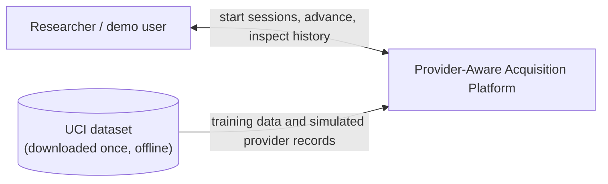
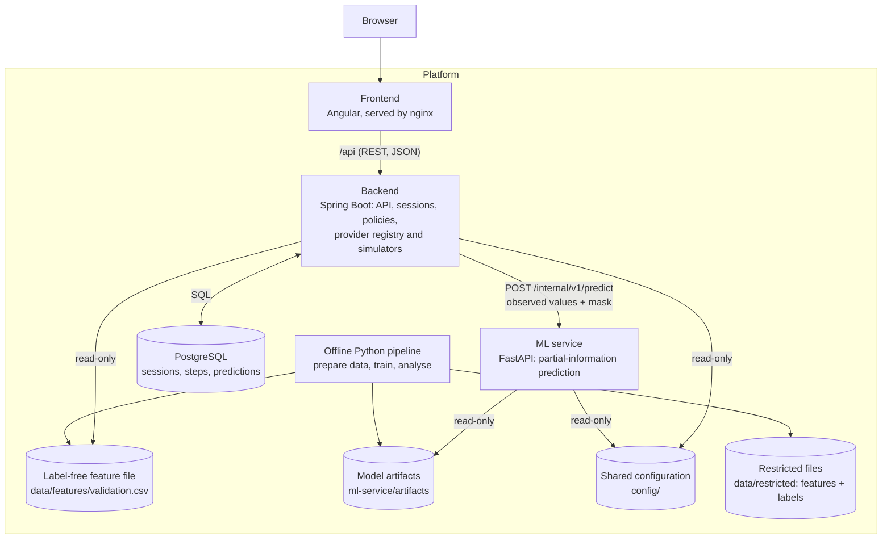
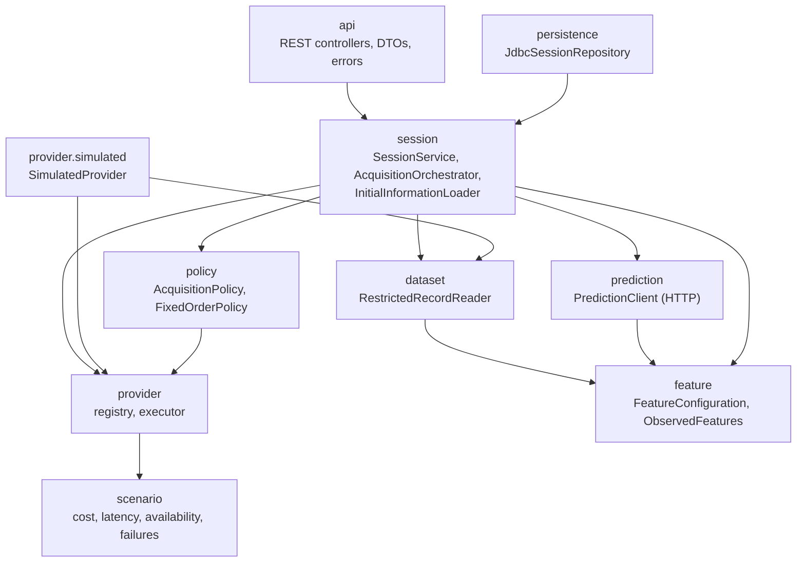
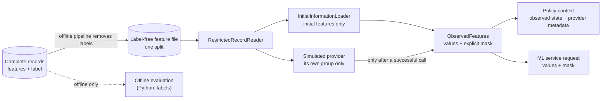
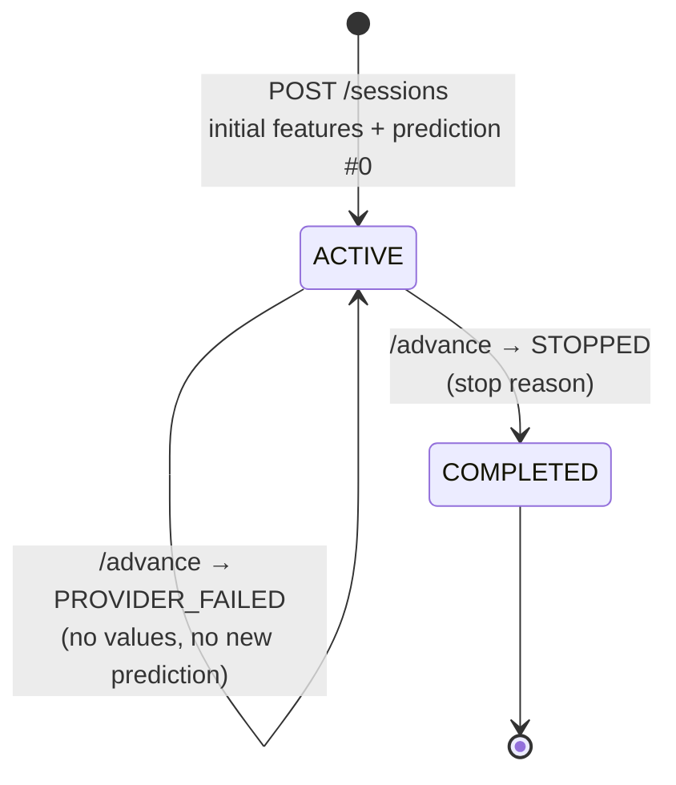
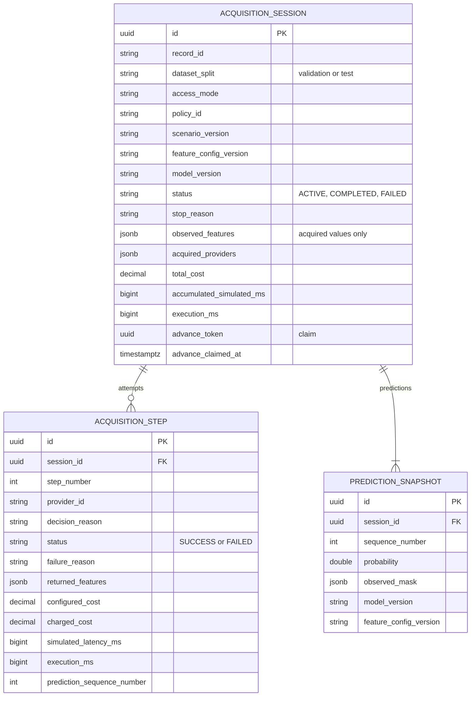
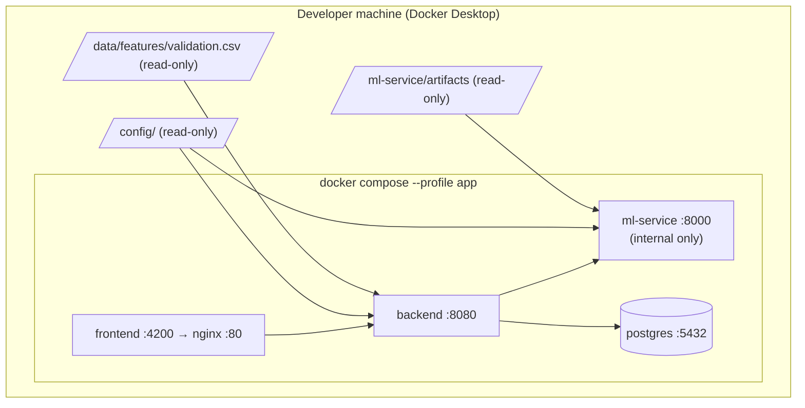

# Architecture

This document describes the system as it is implemented at the end of Phase 2 (Alpha). Planned
parts are marked as such. Requirement IDs (FR, NFR, ER) refer to the requirements of the first
chapter.

## 1. Purpose

The platform studies **provider-aware adaptive information acquisition**: a prediction starts from
a small set of known information, and the system decides, record by record, whether to query
additional information providers. Providers differ in cost, latency and availability, and each one
reveals a group of features. The system records every decision so that adaptive and simple
strategies can be compared on prediction quality, cost, number of calls and time.

The data is the UCI *Default of Credit Card Clients* dataset. Providers are **simulated** from the
complete records; this is an experimental setup, not a real credit-decision system.

## 2. System context



## 3. Containers



| Container | Technology | Responsibility |
|---|---|---|
| Frontend | Angular 22, nginx | User interface; currently an application shell (the session views are planned for the MVP). nginx forwards `/api` to the backend. |
| Backend | Java 25, Spring Boot 4.1 | Public REST API, session lifecycle, acquisition policies, provider registry, simulated providers, persistence |
| ML service | Python 3.13, FastAPI, scikit-learn | Predicts the probability of default from any legal partial observation |
| PostgreSQL | PostgreSQL 18 | Sessions, provider attempts and prediction snapshots |
| Offline pipeline | Python, pandas, scikit-learn | Downloads and splits the dataset, trains and selects the model, analyses provider value |

The ML service receives **only observed values and their mask**, never a record identifier, so it
cannot look up anything else. The frontend talks only to the backend.

## 4. Backend components



| Package | Responsibility | Must not use |
|---|---|---|
| `api` | HTTP endpoints, request validation, response DTOs, error mapping | dataset, simulated providers |
| `session` | Creating sessions, running one decision per `/advance`, history | — |
| `policy` | Deciding *acquire provider X* or *stop* from an `AcquisitionContext` | dataset, simulated providers, provider executor, persistence |
| `provider` | Provider interface, registry (definitions + scenario settings), executor (validation, charging) | — |
| `provider.simulated` | Simulated providers that reveal their own feature group from the complete records | — |
| `scenario` | Loading and validating provider scenarios | — |
| `prediction` | Client for the ML service | dataset, provider, scenario, session |
| `dataset` | The only access to complete records, through two narrow methods | — |
| `feature` | Shared feature grouping and the legal-observation rules | any other package |
| `persistence` | SQL storage of sessions, steps and snapshots | — |

The "must not use" rules and the absence of package cycles are checked by ArchUnit tests on every
build. Further tests run each rule against deliberately broken classes to show that the rules
really detect violations.

## 5. Data visibility boundary

The central correctness property: a policy and the predictive model may only see values that have
been acquired, and never the label (ER-6, NFR-8).



| Safeguard | Where it is enforced | How it is tested |
|---|---|---|
| Labels never reach the backend | The data pipeline writes label-free `features/<split>.csv`; the reader refuses any file whose columns are not exactly ID + model features | Python file tests; Java reader tests with target/demographic columns |
| Training records are never served | Only one split file is loaded; database check allows only `validation` or `test` | Reader and schema tests; real data compared with the split manifest |
| Test records only for final evaluation | `FINAL_EVALUATION` mode starts only with the `final-evaluation` Spring profile | Startup guard tests; verified on the packaged application |
| A session starts with the initial features only | `InitialInformationLoader` | Service, API, database and outgoing ML request checks |
| A provider reveals only its own group | Reader API offers only `initialFeatures(id)` and `providerGroup(id, provider)`; executor rejects any other result | Provider, executor and per-step API tests |
| Unacquired values are never visible | `ObservedFeatures` holds only acquired values; stored state is re-validated on every read | After every `/advance`, responses are searched for hidden feature names; ML request masks checked step by step |
| Missing ≠ zero | Missing values come only from the mask; masks must be whole groups | Java and Python mask tests; zero-value tests |
| Policies cannot reach data | `AcquisitionContext` has no record identifier; ArchUnit rules | Architecture tests |
| Online inference independent of training data | `ml_service.inference` imports no data/training/analysis code | Static and runtime import tests |
| Physical separation in containers | Backend container mounts only the validation feature file; ML container mounts only model artifacts and has no published port | Verified in the running Compose stack |

## 6. Feature grouping and model

`config/feature-groups.json` is read by both Java and Python (version **fg-2**):

| Source | Features |
|---|---|
| Initial information (known at the start) | `LIMIT_BAL`, `BILL_AMT1`, `PAY_AMT1` |
| Repayment History provider | `PAY_0`, `PAY_2`–`PAY_6` |
| Billing History provider | `BILL_AMT2`–`BILL_AMT6` |
| Payment History provider | `PAY_AMT2`–`PAY_AMT6` |

The demographic columns are excluded. Because the initial features are always known and providers
reveal whole groups, every session is in one of **8 observation states**. The grouping was refined
from the first chapter's version during Phase 2; the reasons and evidence are in
[decisions/001-feature-grouping-fg-2.md](decisions/001-feature-grouping-fg-2.md).

**Model.** A single *mask-aware* gradient-boosting model is used for every state and every
strategy, so differences between strategies come from what was acquired, not from different
models. Hidden groups enter the model as missing values (only through the mask) plus one indicator
per group; the model is trained on every training record in all 8 states. It is selected on the
validation split by mean ROC-AUC over the 8 states; the test split is never used for selection.
Full-information models (logistic regression, gradient boosting on all 19 features) are trained
as offline references.

| Validation ROC-AUC (fg-2) | Initial state | All providers | Mean of 8 states |
|---|---|---|---|
| Mask-aware gradient boosting (deployed) | 0.683 | 0.772 | 0.739 |
| Full-information gradient boosting (reference) | — | 0.767 | — |

Per-state PR-AUC, Brier score and log loss are written to the validation report by the training
command.

## 7. Acquisition session

### 7.1 Lifecycle



Stop reasons: `ALL_PROVIDERS_ACQUIRED`, `NO_FEASIBLE_PROVIDERS` (remaining providers failed or are
unavailable), `INSUFFICIENT_EXPECTED_BENEFIT` (reserved for the adaptive policy).

### 7.2 One `/advance`

```mermaid
sequenceDiagram
    participant C as Client
    participant O as Orchestrator
    participant DB as PostgreSQL
    participant P as Policy
    participant E as Provider executor
    participant ML as ML service
    C->>O: POST /sessions/{id}/advance
    O->>DB: claim session (atomic UPDATE, lease 30 s)
    alt already claimed or finished
        O-->>C: 409
    end
    O->>DB: read current state
    O->>P: selectNext(observed state, feasible provider metadata)
    alt Stop
        O->>DB: complete session, release claim (one transaction)
        O-->>C: STOPPED
    else Acquire provider
        O->>E: execute(provider)
        E-->>O: values of that group, or failure
        opt success
            O->>ML: predict(observed values + mask)
            ML-->>O: probability
        end
        O->>DB: save step, prediction, new state; release claim (one transaction, only if still claimed)
        O-->>C: ACQUIRED or PROVIDER_FAILED
    end
```

No database transaction is open during the provider and ML calls. If anything fails before saving,
the claim is released and the session is unchanged; if the process crashes, the claim expires.
Only one advance per session can run at a time.

### 7.3 Provider simulation rules

| Situation | Selectable | Step recorded | Cost charged | Simulated latency | Values | New prediction |
|---|---|---|---|---|---|---|
| Provider unavailable | No | No | 0 | 0 | — | No |
| Call succeeds | Yes | Yes | Configured cost | Configured latency | Its own group | Yes |
| Call fails | Yes | Yes (with reason) | 0 | Configured latency | — | No |

Latency is **virtual**: it is recorded, not waited for, so experiments run quickly and simulated
time stays separate from real processing time (NFR-12). Failures are decided from the scenario
seed, record and provider, so the same scenario always gives the same failures (NFR-6). A failed
provider is not retried in the same session. Costs are experimental units.

### 7.4 Policies

`AcquisitionPolicy` receives an `AcquisitionContext` (observed values and mask, latest probability,
feasible providers with their public metadata, attempted providers, totals) and returns
`Acquire(provider, reason)` or `Stop(reason)`. Policies never call providers or store anything.
Implemented: `FIXED_ORDER` (same order for every record; stops when no feasible provider remains).
Planned: full acquisition, random order, cost-first, latency-first, budgeted variants and a
provider-aware adaptive policy.

## 8. Data model



Database constraints enforce: one attempt per provider per session; unique step and prediction
numbers (predictions are never overwritten); a successful step has values and a failed step has a
reason; probabilities between 0 and 1; a finished session has a stop reason. The schema is managed
by Flyway (`backend/src/main/resources/db/migration`).

## 9. API

| Method and path | Purpose |
|---|---|
| `GET /api/v1/providers` | Providers with their features and the active scenario's cost, latency and availability |
| `POST /api/v1/sessions` `{"recordId", "policyId"}` | Start a session from the initial information; returns 201 with the initial prediction |
| `GET /api/v1/sessions/{id}` | Observed values and mask, acquired and remaining providers, predictions, steps, totals |
| `POST /api/v1/sessions/{id}/advance` | One decision: `ACQUIRED`, `PROVIDER_FAILED` or `STOPPED` |
| `POST /internal/v1/predict` (ML service) | Probability for observed values and mask; not exposed outside the backend network |

Errors have the form `{"error": "...", "message": "..."}`:

| Status | Codes |
|---|---|
| 400 | `INVALID_REQUEST` (including unknown fields), `UNSUPPORTED_POLICY` |
| 404 | `RECORD_NOT_AVAILABLE` (not in the served split), `SESSION_NOT_FOUND` |
| 409 | `SESSION_NOT_ACTIVE`, `ADVANCE_IN_PROGRESS`, `ADVANCE_DISCARDED` |
| 502 | `ML_SERVICE_REJECTED` |
| 503 | `ML_SERVICE_UNAVAILABLE` (nothing is created or changed) |

## 10. Configuration

| File | Content |
|---|---|
| `config/feature-groups.json` | Initial features, provider groups, excluded columns (read by Java and Python) |
| `config/scenarios/*.json` | Provider cost, latency, availability and failure rate, plus a seed |
| `data/dataset-source.json` | Dataset URL, checksum, split method and seed |
| `backend/src/main/resources/application.yaml` | Backend settings; every path and URL can be overridden by environment variables |

The default scenario is neutral (all providers cost 1, take 200 ms, are available and never fail).
Calibrated scenarios for the experiments are planned.

## 11. Deployment



Without the `app` profile, `docker compose up -d` starts only PostgreSQL, for development where
the other services run from the IDE or a terminal. Images use pinned versions and run as non-root
users. The dataset and model are not part of any image; they are generated locally and mounted.

## 12. Testing

| Part | Tests | Main tools |
|---|---|---|
| ML service | 147 | pytest; synthetic data for unit tests; real-data tests skip until the data is prepared |
| Backend | 162 (+2 contract tests that run when the ML service is up) | JUnit 5, AssertJ, Mockito, Testcontainers (real PostgreSQL), ArchUnit |
| Frontend | 3 | Vitest |
| Whole system | `scripts/smoke_test.py` | One full session through the public API with leakage checks |

## 13. Design decisions

| ID | Decision |
|---|---|
| D1 | Modular Spring Boot monolith with internal simulated providers behind an `InformationProvider` interface; separate FastAPI service for inference |
| D2 | Policies decide, the orchestrator acts: policies never call providers or store data |
| D3 | Virtual provider latency; simulated time and real processing time stored separately |
| D4 | Labels physically separated from the backend's data; offline metrics computed in Python |
| D5 | Eight observation states; group-level mask validation; one mask-aware model for all strategies |
| D6 | One shared feature configuration file for Java and Python, with a version checked against the model |
| D7 | Validation split for development, test split only in final-evaluation mode |
| D8 | Committed split manifest and dataset checksum; data and models regenerated, not committed |
| D9 | Atomic claim per session for `/advance`; no transaction during external calls |
| D10 | Package boundaries checked by ArchUnit |
| D11 | Feature grouping fg-2 (see decision 001) |
| D12 | Persistence with plain SQL (`JdbcClient`) instead of JPA, for JSONB columns and the atomic claim |
| D13 | Backend runs in UTC |

## 14. Not implemented yet

- Adaptive policy and expected-information-value estimation; further baselines and budgets.
- Batch experiment runner, experiment-run storage, offline evaluation of stored sessions.
- Calibrated experimental scenarios and an API to change them.
- Session views in the frontend.
- Authentication (the platform is a local research tool).
